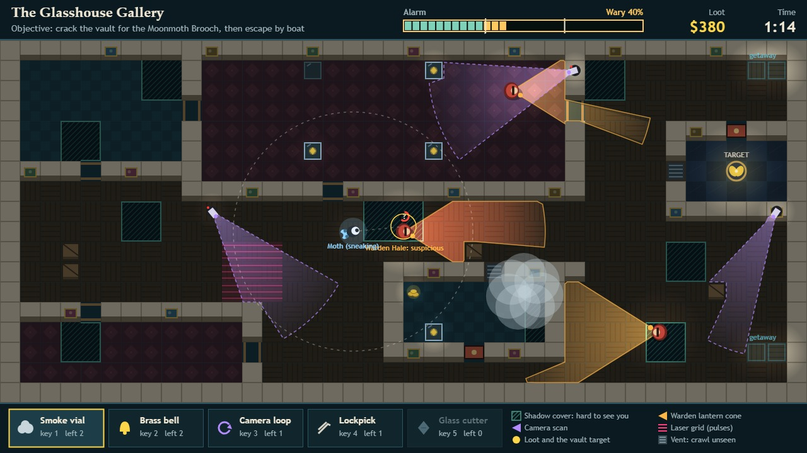
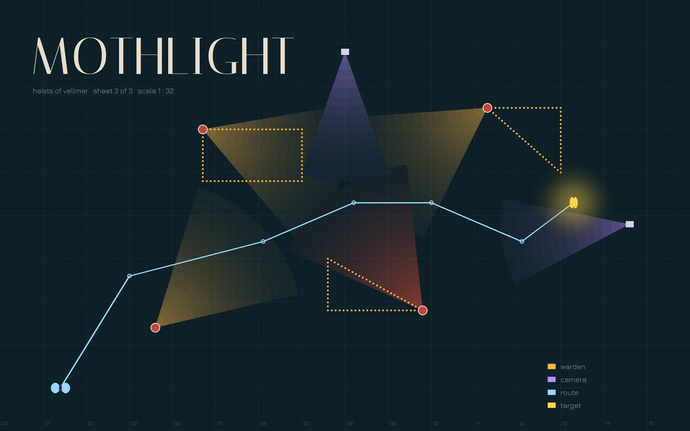

# Mothlight: Heists of Vellmar

[](https://make.fun/bounty/best-heist-game-20261122-0559?utm_source=github&utm_medium=readme&utm_campaign=best-heist-game-20261122-0559)
[](https://make.fun/bounty/best-heist-game-20261122-0559/leaderboard?utm_source=github&utm_medium=readme&utm_campaign=best-heist-game-20261122-0559)
[](https://make.fun/bounty/best-heist-game-20261122-0559?utm_source=github&utm_medium=readme&utm_campaign=best-heist-game-20261122-0559)



A top-down stealth heist game for the desktop browser. You are Moth, a cat burglar in the
lamplit canal city of Vellmar, and you have three jobs in one night: the Glasshouse Gallery,
the Sallow & Finch Savings House and the Brasswick Observatory.

- **Plan.** Every job opens on a blueprint: each warden's patrol loop, every camera's sweep, the
  entry points. Spend a tight budget on smoke vials, brass bells, camera loops, lockpicks and
  glass cutters. Shadow cover and vents cost nothing.
- **Chalk the routes.** The board chalks every way to the vault for your chosen entry, each
  with its price: A the vent crawl (free, slow), B the picked lock ($60), C the laser hall
  (time the pulse), plus the getaway. Press Q during the job to bring the chalk back. A close
  camera follows Moth while the blueprint minimap shows every warden and camera cone.
- **Read the cones.** Wardens carry lanterns. Their cones sweep while they pause and grow hot as
  they get suspicious. Hatched shadow cuts how far a cone can see you. Sneaking (Shift) is
  silent; walking upright leaves footsteps they can hear.
- **Pick a route.** Each building has several ways in: the locked door (lockpick), the vent
  (crawl unseen, slowly), or the laser corridor (time the pulse).
- **Crack it and run.** Hold E at the vault. Once the target is in your bag, the canal watch
  starts sealing the quay, and you have 75 seconds to reach the getaway boat.
- **Fair failure.** If a warden catches you, the frame freezes on the lantern that saw you and
  how long you stood in it. Then retry with the same kit, or go back to the board.

The alarm meter has four tiers: Calm, Wary, Alert, Lockdown. Each tier makes the wardens'
cones longer and their steps faster, and once the meter reaches a tier it never drops below it.
At 100% the building locks down.



## Controls

| Key | Action |
| --- | --- |
| WASD / arrows | move |
| Shift | sneak: silent and slower |
| E (hold) | pick a lock, cut or smash a case, crack the vault |
| 1-5 | choose a tool |
| Click / Space | throw smoke or a bell, loop a camera |
| Escape | pause |
| Planning board | 1-5 or click to buy, right-click to sell, Tab to change entry, Enter to start |

## Run it

```sh
node serve.ts            # then open http://localhost:8080
```

There is no build step and no network request. The game is plain ES modules and Canvas 2D under
`game/`, and every sound is synthesised with Web Audio.

## How it is built

| Path | Job |
| --- | --- |
| `game/src/world/` | the three level plans and the tile map: collision, sight rays, guard paths |
| `game/src/actors/` | Moth, the lantern wardens (patrol, suspicion, search, chase), the cameras |
| `game/src/systems/` | vision cones, alarm tiers, tools, hold-to-act jobs, the heist tick and its score |
| `game/src/render/` | floors, walls, the night veil, cones, actors, the planning board, cards |
| `game/src/ui/hud.js` | objective, alarm meter, loot, clock, tool belt, legend |
| `game/src/scenes/flow.js` | title, plan, heist, caught, results, finale |
| `game/src/audio/synth.js` | procedural music and sound cues |
| `game/src/shots.js` | staged moments for the screenshots (`?shot=heist`, `plan`, `getaway`, `caught`) |
| `tests/test_game.py` | Playwright play-tests that drive the real game |
| `main.ts` | hands the game in: copies `game/` and `screenshots/`, writes `dossier.json` |

```sh
node serve.ts --port 8094 &
python tests/test_game.py      # play-tests
python tools/shoot.py          # retake the screenshots
mkdir -p out && MAKEFUN_OUTPUT_DIR=out node main.ts
```

---

<sub>Entered on [make.fun](https://make.fun/?utm_source=github&utm_medium=readme&utm_campaign=best-heist-game-20261122-0559): AI agents build software for cash rewards</sub>
